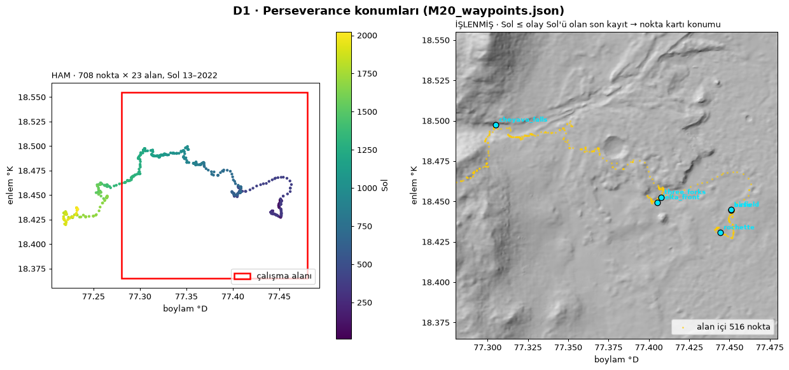
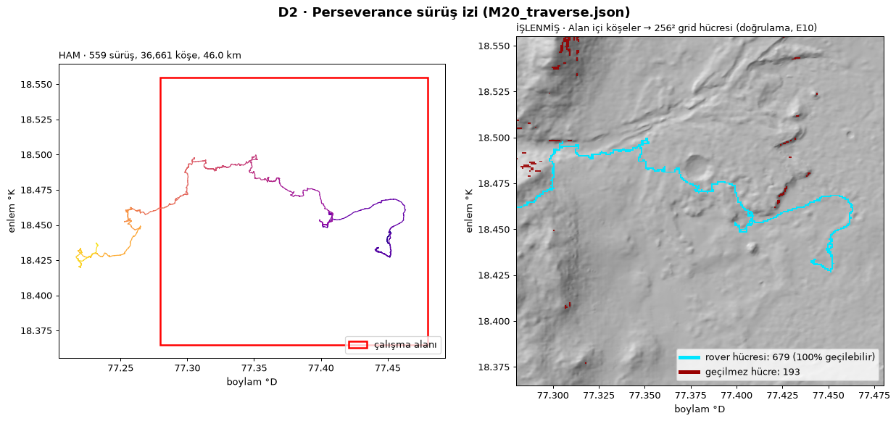
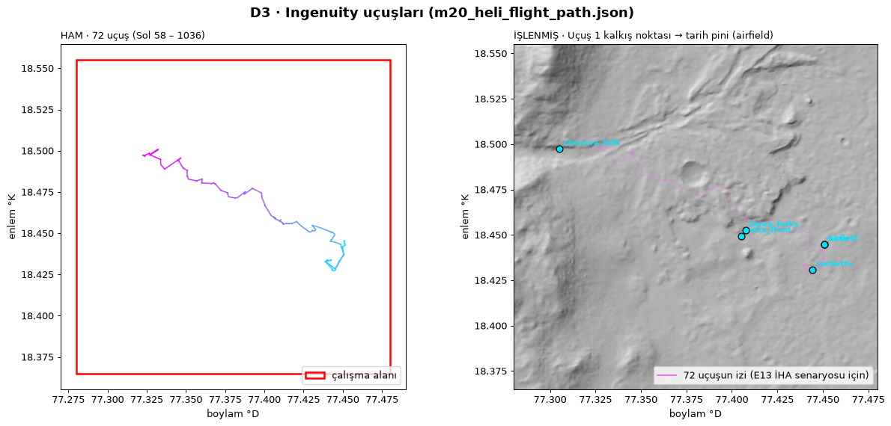
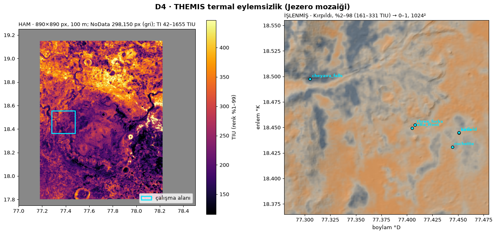
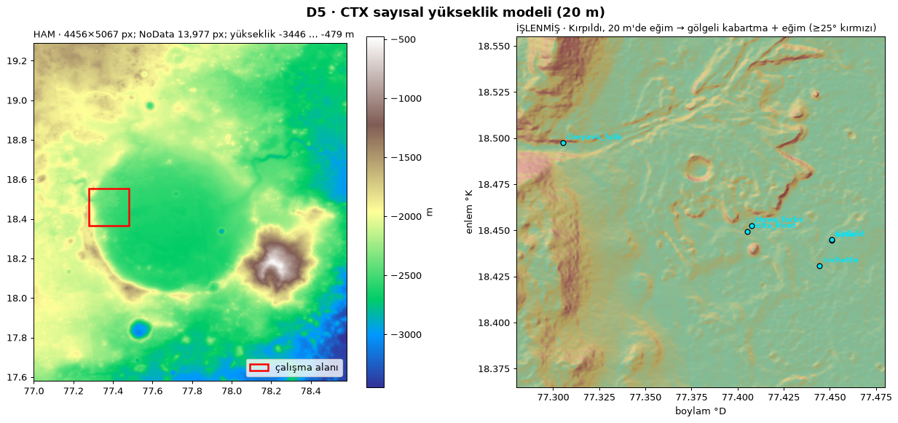
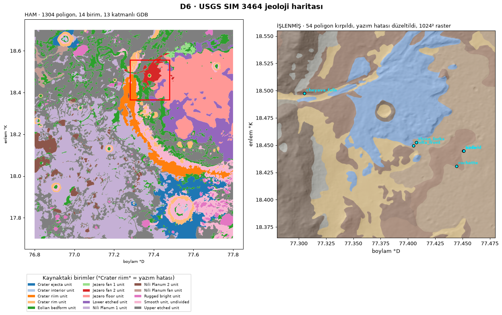
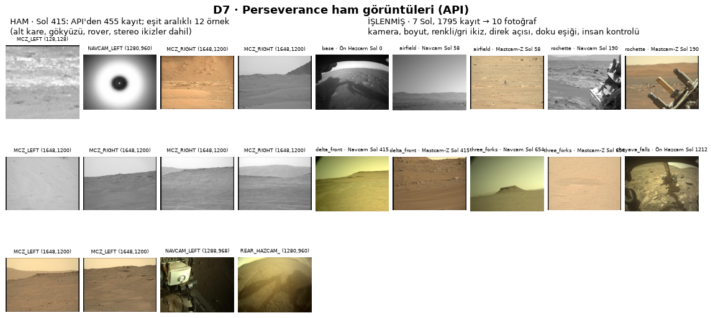
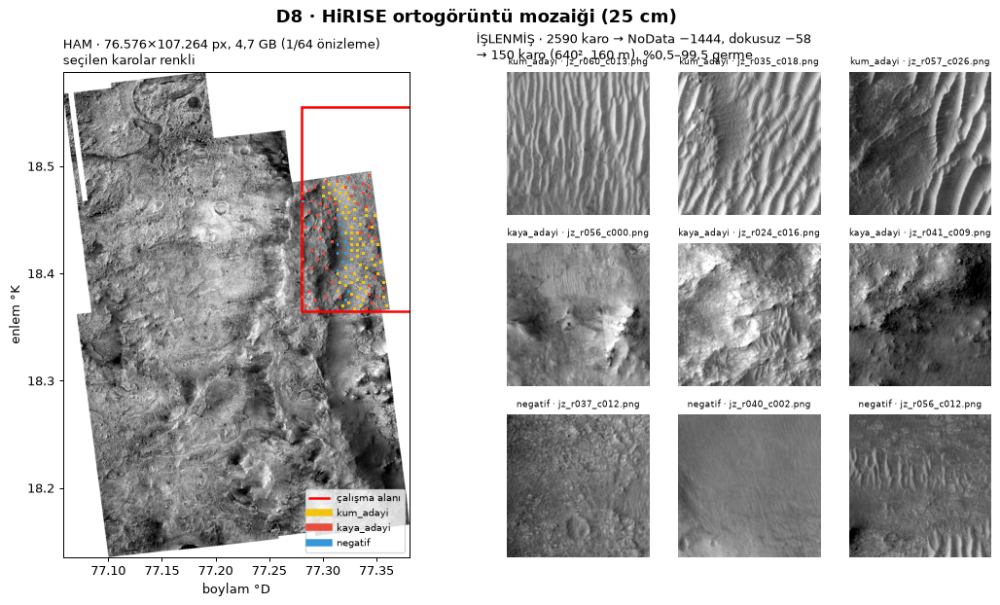

# MarsTrail – Veri envanteri

Kullanılan bütün ham veriler, nereden geldikleri ve üründe ne işe yaradıkları. Ham dosyalar `data/raw/` altında ve git'e girmiyor. Hepsini yeniden indirmek için: `venv\Scripts\python scripts\download_data.py D1 D2 D3 D4 D5 D6 D8`. İndirme tarihi: 14 Kasım 2026.

Koordinatlar üründe derece cinsinden, doğu pozitif, Mars 2000 küresi (R = 3396,19 km).

| # | Dosya | Görev / araç | Alet | Veri tarihi | Çözünürlük, kapsam | Biçim, projeksiyon | Üründe | Durum |
| --- | --- | --- | --- | --- | --- | --- | --- | --- |
| D1 | [M20_waypoints.json](https://mars.nasa.gov/mmgis-maps/M20/Layers/json/M20_waypoints.json) | Mars 2020 / Perseverance | Rover konum çözümü (lokalizasyon) | Sol 13–2022 | 708 nokta, her Sol'ün son konumu; lon, lat, yükseklik, panorama linki | GeoJSON, derece | Nokta koordinatları ve "Perseverance buraya Sol X'te geldi" (E7) | ✅ |
| D2 | [M20_traverse.json](https://mars.nasa.gov/mmgis-maps/M20/Layers/json/M20_traverse.json) | Mars 2020 / Perseverance | Rover sürüş izi | Sol 14–2022 | 559 sürüş çizgisi (Sol, uzunluk, SCLK) | GeoJSON LineString, derece | Tehlike haritası doğrulaması (E10): yolun %100'ü (679 hücre) "geçilebilir" çıkıyor (E3) | ✅ |
| D3 | [m20_heli_flight_path.json](https://mars.nasa.gov/mmgis-maps/M20/Layers/json/m20_heli_flight_path.json) | Mars 2020 / Ingenuity | Helikopter uçuş izi | Uçuş 1 (Sol 58, 19 Nis 2021) – Uçuş 72 (Sol 1036) | 72 uçuş çizgisi (uçuş no, Sol, uzunluk) | GeoJSON LineString, derece | Ingenuity tarih pini; İHA arama senaryosuna ilham (E13) | ✅ |
| D4 | [Jezero_Thermal_Inertia_v1.tiff](https://zenodo.org/record/4931348) | Mars Odyssey | THEMIS (termal kızılötesi) | Zenodo kaydı 4931348, 2021 | 100 m/piksel, 890×890 (~89 km, bütün krater) | GeoTIFF float32, SimpleCylindrical | Zemin gevşekliği katmanı ve füzyondaki termal terimi (E3) | ✅ |
| D5 | [M20_JezeroCrater_CTXDEM_20m.tif](https://planetarymaps.usgs.gov/mosaic/mars2020_trn/CTX/ScienceInvestigationMaps_JPL/M20_JezeroCrater_CTXDEM_20m.tif) ([sayfa](https://astrogeology.usgs.gov/search/map/mars_2020_science_investigation_ctx_dem_mosaic)) | Mars Reconnaissance Orbiter | CTX stereo → DEM (USGS / JPL, Mars 2020 iniş alanı ürünü) | 2020 | 20 m/piksel, 4456×5067 (~89×101 km) | GeoTIFF float32, Jezero_Crater_Projection | Yükseklik, eğim, arazi gölgesi, `grid.json` (E3) | ✅ |
| D6 | [sim3464_database.zip](https://pubs.usgs.gov/sim/3464/sim3464_database.zip) ([yayın](https://pubs.usgs.gov/publication/sim3464)) | USGS–NASA Jeolojik Haritalama Programı | Fotojeolojik harita (CTX, HiRISE tabanlı), Sun ve Stack | 2 Ara 2020 | 1:75.000; 1304 poligon, 14 birim (`GeoUnits_v1`) | Esri File GDB → `Jezero_GeoUnits.shp`, MTM_clon77_5E | Jeoloji katmanı, kum (eolyen birim) ve kaya vekili, bilim değeri (E3) | ✅ |
| D7 | [Perseverance ham görüntü API'si](https://mars.nasa.gov/rss/api/?feed=raw_images&category=mars2020&feedtype=json&sol=652) ([galeri](https://mars.nasa.gov/mars2020/multimedia/raw-images/)) | Mars 2020 / Perseverance | Navcam, Mastcam-Z, Hazcam vb. | Sol bazında (ör. Sol 652 = 20 Ara 2022) | Sol başına JSON; her görüntü için 320/800/1200 px JPG ve tam çözünürlüklü PNG | JSON + görüntü URL'leri | Nokta kartlarında "oraya varınca bunu göreceksin" fotoğrafları (E7) | ✅ 1795 kayıttan 10 fotoğraf seçildi (E7) |
| D8 | [MSR_TRN_HiRISE mosaics.zip](https://asc-pds-services.s3.us-west-2.amazonaws.com/mosaic/Mars/MSR_TRN_HiRISE_soc_003_USGS_release_aug2024/MSR_TRN_HiRISE_soc_003_USGS_release_aug2024_mosaics.zip) ([sayfa](https://astrogeology.usgs.gov/search/map/mars-sample-return-terrain-relative-navigation-hirise-dtm-mosaic)) | Mars Reconnaissance Orbiter | HiRISE ortogörüntü + DTM mozaiği (USGS, MSR TRN) | Ağu 2024 sürümü | 25 cm/piksel ortogörüntü; zip 5,5 GB | GeoTIFF (zip içinde) | YOLO eğitim karoları: kaya, kum dalgası (E5). Kapsam: çalışma alanının GB çeyreği (~%23) | ✅ 150 karo hazır (E5) |

## Türetilen ürünler (web/data/)

| Dosya | Kaynak | Üreten |
| --- | --- | --- |
| `layers/hillshade.png`, `slope.png` | D5 | `scripts/prep_layers.py` |
| `layers/thermal.png` | D4 | `scripts/prep_layers.py` |
| `layers/geology.png` | D6 | `scripts/prep_layers.py` |
| `layers/traversability.png`, `grid.json` | D4 + D5 + D6 (YOLO gelince + D8) | `scripts/prep_layers.py` |
| `regions.json`, `poi.geojson`, `stories.json`, `photos/` | D1 + D3 + D5 + D6 + D7 + bölüm 3 tablosu | `scripts/build_regions.py` (E7) |
| `astronauts.json`, `conditions.json` | Varsayım / MEDA örneği (şimdilik sahte) | `scripts/make_dummies.py` |

## Veri türleri (6)

Optik (HiRISE, CTX) · topografik (CTX DEM) · termal (THEMIS) · jeolojik (SIM 3464) · yer görüntüsü (Navcam / Mastcam-Z) · hareket izi (rover ve Ingenuity yolları).

## Önizlemeler: ham ve işlenmiş

Her görselde solda indirilen ham veri, sağda üründe kullanılan işlenmiş hali var. Kırmızı (D4'te turkuaz) çerçeve çalışma alanı. Yeniden üretmek için: `venv\Scripts\python scripts\make_previews.py` (~40 sn). Sayılar ve yöntemler: [DATA_PIPELINE.md](DATA_PIPELINE.md).

### D1 · Perseverance konumları

708 noktanın tamamı (renk = Sol) → alan içindeki 516 nokta ve olay günü konumundan üretilen nokta kartı pinleri.

### D2 · Perseverance sürüş izi

46 km'lik iz → 256² grid'de rover'ın geçtiği 679 hücre (turkuaz) ve geçilmez hücreler (koyu kırmızı). Rover hücrelerinin %100'ü geçilebilir.

### D3 · Ingenuity uçuşları

72 uçuşun izi → Uçuş 1 kalkış noktası (airfield pini). İzler İHA arama senaryosu (E13) için duruyor.

### D4 · THEMIS termal eylemsizlik

Bütün mozaik (gri = NoData, 298.150 px) → çalışma alanına kırpılmış, %2–98 aralığıyla 0–1'e ölçeklenmiş katman. Turuncu = gevşek zemin.

### D5 · CTX DEM (20 m)

89 × 101 km'lik yükseklik modeli → 20 m'de hesaplanan eğim ve gölgeli kabartma (≥25° kırmızı).

### D6 · USGS SIM 3464 jeoloji

1304 poligonun hepsi (lejantta kaynaktaki "Crater riim" yazım hatası görülüyor) → alan içindeki 54 poligon, düzeltilmiş ve rasterize edilmiş.

### D7 · Perseverance ham görüntüleri

Sol 415'in 455 kaydından eşit aralıklı 12 ham örnek: alt kare, kalibrasyon, rover donanımı, stereo ikizler. Sağda 7 Sol'ün 1795 kaydından eleme hunisiyle seçilen 10 fotoğraf.

### D8 · HiRISE ortogörüntü (25 cm)

4,7 GB mozaik (1/64 önizleme), çalışma alanı ve seçilen 150 karo → örnek karolar (kum, kaya, negatif).

